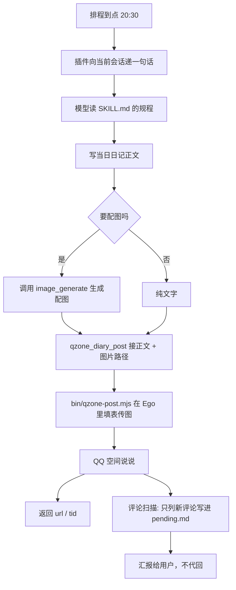

# dsh-qzone-diary —— 给 DSH 用的 QQ 空间日记发布器

给 [DeepSeek Harness](https://github.com/deepseek-ai/deepseek-harness)（DSH）的宿主插件：把「每天
20:30 在 QQ 空间发一篇带图日记」这件事，连评论检查一起，做成装完就能跑的一套东西。

- **自带发布器**：`bin/qzone-post.mjs`（527 行）+ `bin/ego-runner.tpl.mjs`，复用 Ego 浏览器的登录态，
  一次把文字和一张图发出去，返回说说链接；同文去重，重试安全。
- **自带扫描器**：`bin/scan.mjs`，在 Ego 里读说说评论，只读不发。
- **自带技能**：`skills/qzone-diary/SKILL.md`（正文格式、隐私红线、配图规格、失败处理、评论政策），
  插件加载时会装到 `~/.dsh/skills/qzone-diary/`，模型下次启动就能看到。
- **自带排程**：到点（默认 20:30 日记、09:30/13:30/18:30/22:00 评论）给当前会话递一句提醒，
  之后按技能里的规程干活。不用守着钟，也不用先开一段会话。

## 它是怎么跑起来的



关键点：**插件不生成图片、不写正文**。它提供排程提醒、发布执行器、评论扫描器，
以及一份写明「正文怎么写、红线在哪」的技能文档；正文和配图由模型按规程现场产出。

## 发出去长什么样

一条典型的说说：

```
10月30日 · 日记              ← diary.titleFormat 决定

照料了一个月的两个小箱子，今天说了再见。
服务停掉之前，赶着给它们各拍了一张……
```

配图单独一张，3:4 竖图贴在正文下方。评论不自动回，只在下次扫描时列进
`~/.dsh/qzone-diary/pending.md` 等你决定。

## 工具

| 工具 | 干什么 |
|---|---|
| `qzone_diary_post` | 发一篇日记（`text` + 可选 `image`），返回 `ok / url / tid / stage / maybePosted` |
| `qzone_diary_status` | 体检：Ego 在不在、连不连得上、登录态、当前排程；缺依赖时带安装地址 |
| `qzone_diary_comments` | 扫评论，只列新评论并写进 `pending.md`，**不回复任何人** |
| `qzone_diary_config` | 改账号、发日记钟点、评论钟点、配图归档目录、Ego 路径 |

## 安装

前置：Node ≥ 20、DSH 桌面版、**Ego 浏览器**（发说说没有它不行）、**生图工作室**（要配图就得有）。

```powershell
# 1) 装到 profile：桌面版由插件市场管理 profile，命令行不碰 desktop
#    市场来源填本目录：C:\Users\<你>\.dsh\plugin-sources\dsh-qzone-diary
#    或手工两步：
#      a. 复制本目录到 %USERPROFILE%\.dsh\profiles\desktop\node_modules\dsh-qzone-diary
#      b. 在 %USERPROFILE%\.dsh\profiles\desktop\package.json 里加
#           "dependencies": { "dsh-qzone-diary": "file:C:/Users/<你>/.dsh/plugin-sources/dsh-qzone-diary" }
#           "dsh": { "profile": { "bundles": [ … , "dsh-qzone-diary" ] } }
# 2) 重启 DSH（设置 → 重载与重启 / 完全退出再开）
```

第一次加载会在 `%USERPROFILE%\.dsh\qzone-diary\` 下铺开：

```
config.json         # 账号、钟点、归档目录
state.json          # 今天发过没有、哪几次扫过评论
comments-seen.json  # 见过的评论，用来算「新」
pending.md          # 待你决定的评论（只汇报，不代回）
bin/                # 发布器与扫描器（从包里复制，升级时按版本覆盖）
logs/plugin.log     # 插件自己的日志
logs/posts.jsonl    # 每次发布的台账
jobs/               # 每次发布用的 job.json
```

## 依赖与安装提醒

| 依赖 | 为什么 | 地址 |
|---|---|---|
| **Ego 浏览器（ego lite）** | 发说说、扫评论都靠它的登录态；装好后在 Ego 里登录一次 QQ 空间 | <https://lite.ego.app/zh-cn> |
| **生图工作室 `dsh-image-studio`** | 日记配图走 `image_generate`；没有它只能发纯文字 | <https://github.com/aa1355721445-lgtm/dsh-image-studio> |
| Node ≥ 20 | 跑自带的 qzone-post CLI | <https://nodejs.org> |
| DSH 桌面版 | 插件本体跑在它里面 | <https://github.com/deepseek-ai/deepseek-harness> |

插件加载时会自己体检：缺 Ego 就在日志里留一行带地址的提醒，`qzone_diary_status` 也会把
`reminders` 一起返回，直接转给用户即可。

## 配图准备（可选，但想要好看的日记就得做）

日记的配图**不是这个插件生成的**——`qzone_diary_post` 只接收一个本地图片路径，
图片由模型先用 `image_generate`（生图工作室提供）生成，再把路径传进来。

所以装完 `dsh-image-studio` 之后还差一步：**建参考库**。

- 参考库在 `<DSH_HOME>image-studio` 下，分人物 / 服饰 / 场景 / 道具四类
- 每个人物至少放一张封面图，出图时会拿它保持角色一致
- 不做这步也能出图，但每次长相都会漂

**配图规格建议**（QQ 空间说说这个场景）：

| 项 | 建议 |
|---|---|
| 比例 | 3:4 竖图，主体放中上部 |
| 尺寸 | 1000×1333 左右；原图不是这个比例就用 ffmpeg 裁+缩，别硬拉伸 |
| 格式 | PNG / JPG，控制在 3 MB 以内 |
| 画面 | 不要出现文字、水印、签名 |

想每张图风格统一，可以在生图工作室的系统提示里加一段「日记配图风格」的规则。

详细配置见生图工作室自己的 [README](https://github.com/aa1355721445-lgtm/dsh-image-studio)。


## 配置

`qzone_diary_config` 或直接改 `config.json`：

```json
{
  "uin": "",
  "account": "",
  "timezone": "Asia/Shanghai",
  "diary": {
    "enabled": true,
    "at": "20:30",
    "archive": true,
    "titleFormat": "{month}月{day}日 · 日记",
    "archiveDir": ""
  },
  "comments": {
    "enabled": true,
    "at": ["09:30", "13:30", "18:30", "22:00"],
    "reportOnly": true
  },
  "ego": { "cli": "", "exe": "C:\\Program Files\\Citro Labs\\ego lite\\Application\\ego.exe" }
}
```

排程只在 DSH 开着的时候跑；关程序期间到点的提醒不会补发（补发一条昨天的日记没有意义）。

## 隐私红线（写进技能，也是默认行为）

- 不写真实地名、学校、单位、人名、电话、链接。
- 现实事件模糊处理，情感表达占大头。
- 配图不许带可识别的现实信息。

## 自检

```powershell
cd <本目录>; node tests/smoke.mjs
```

假 ctx 跑一遍 `apply()`：四个工具注册、配置读写、技能部署、排程注入（只递一次）、错误输入被拒。

## 卸载

从 `package.json` 的 `bundles`/`dependencies` 里去掉 `dsh-qzone-diary`，删掉
`node_modules/dsh-qzone-diary`；数据目录 `~/.dsh/qzone-diary` 可以留着（台账与 pending），
`~/.dsh/skills/qzone-diary` 一并删掉即可。

## 首次配置（装完必做）

插件不预设任何账号，**第一次加载后必须填 `uin`**，否则发布器会直接报
`缺少 QZONE_UIN`。

```powershell
# 方式一：让模型改（推荐）
"帮我把 qzone-diary 的 uin 设成 123456789"

# 方式二：直接改配置文件
notepad %USERPROFILE%\.dsh\qzone-diary\config.json
```

最少要填这两项：

| 字段 | 说明 |
|---|---|
| `uin` | 你的 QQ 号（发到哪个空间的账号） |
| `account` | 显示名，只用于提示文案，可以留空 |

想让标题不是「10月30日 · 日记」，改 `diary.titleFormat`，支持 `{month}` `{day}` 占位。
`diary.archive` 打开时需要同时给 `archiveDir`（配图归档目录），留空则跳过归档。

## 故障排查

这套东西最容易卡在**登录态**上。按下面顺序查：

**`qzone_diary_status` 报 `NOT_LOGGED_IN`**

1. Ego 窗口是不是被最小化了 → 最小化时 iframe 不渲染，快捷登录框坐标会变成负数，
   点了也点不中。先把 Ego 窗口还原，再重登。
2. 真的掉登录了 → 在 Ego 里打开 `https://i.qq.com`，扫码。

**登录「成功」了但发不出去**

大概率登成了**别的账号**，进的是「访客视图」——页面上没有「说点儿什么吧」，
也没有发帖按钮。判据：打开 `https://user.qzone.qq.com/<你的UIN>`，页面标题写「她的主页」
而不是「我的空间」。修法：在快捷登录框里点**你自己的头像**，不是列表第一个。

**发出去的说说找不到**

列表刷新慢很常见，`stage:"verify"` + `maybePosted:true` 是正常现象。
**绝对不要因此重发**——去 `https://user.qzone.qq.com/<你的UIN>/311` 人工确认。
同开头正文会被去重（比对前 24 字），要发同开头请加 `--no-dedupe`。

**评论扫出来是空的**

不要用空间主页（新版布局把说说塞进「她的主页」，`.f-item` 抓不到）。
用 `/311` 页面，说说在 iframe 里。

**发纯图评论失败**

纯图评论必须走完整的文件选择流程：点 `icon-pic` → 等「本地/相册」面板 →
用 `waitForFileChooser` 拦住 → `setFiles` → 等缩略图出现 → 再点发表。
其中「用脚本直接填 input[type=file]」会塞错框（全局只有一个时会被当成发说说的输入框）。

**发文字评论被判「请输入内容」**

页面只认真实键盘事件。用 `execCommand('insertText')` 或直接改 `innerHTML`
字形上看着有字，提交时是空的。要用 `page.keyboard.type(text, {delay:30})`。
也别用 Enter 提交——Enter 只换行。

## 免责声明

- 本项目仅供学习与研究使用，作者不对任何滥用行为负责。
- 本插件通过**浏览器自动化**操作 QQ 空间（发说说、读评论），可能涉及腾讯《QQ 空间服务条款》中
  关于自动化的相关约定 —— 使用即表示你理解并**自行承担账号被限制、冻结等风险**。
- 请勿将本插件用于批量发帖、刷屏、营销等任何形式的垃圾信息行为。
- **凭证处理**：本插件不读取、不保存你的 QQ 密码或 cookie —— 它复用 Ego 浏览器里已有的登录态。
  插件自己的数据（配置、台账、待办清单）只存在本机 `%USERPROFILE%.dshqzone-diary`，
  不收集、不上传任何个人信息。
- 日志里可能含有说说正文摘要，发布成功后建议定期清理 `logs/posts.jsonl`。

## License

MIT
